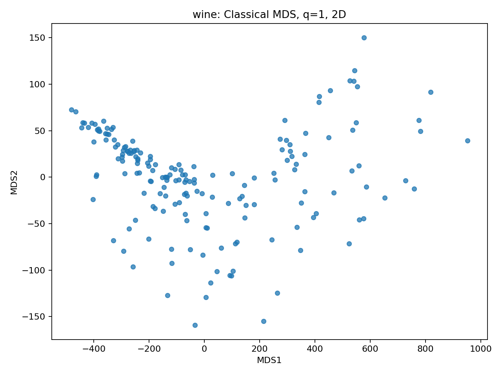
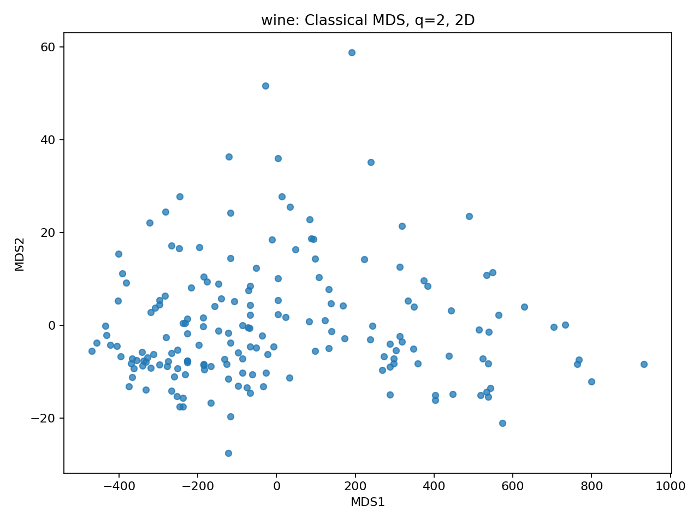
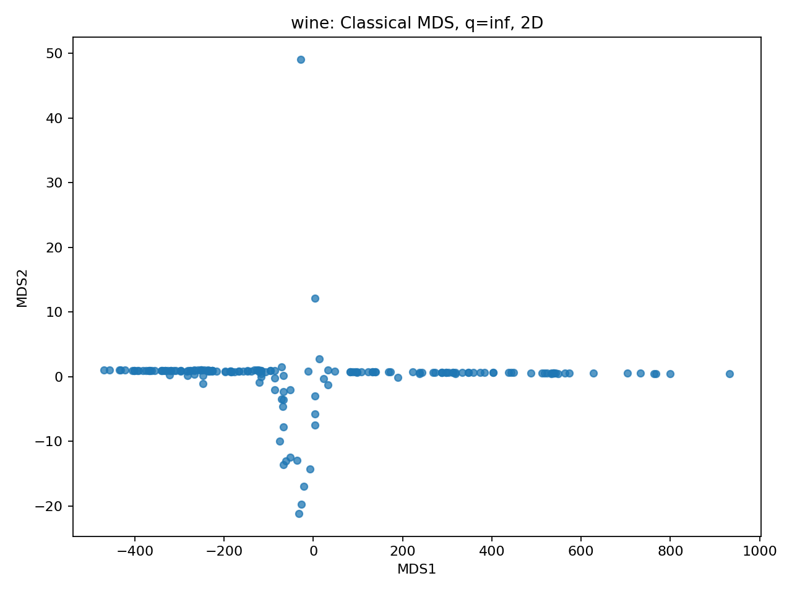
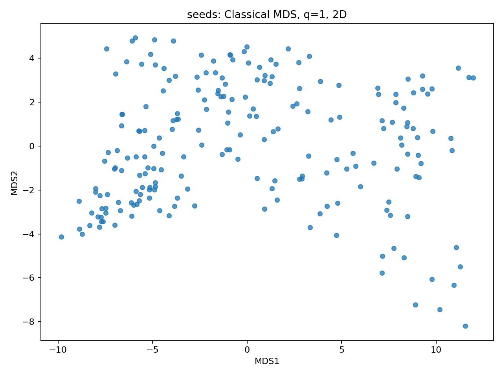
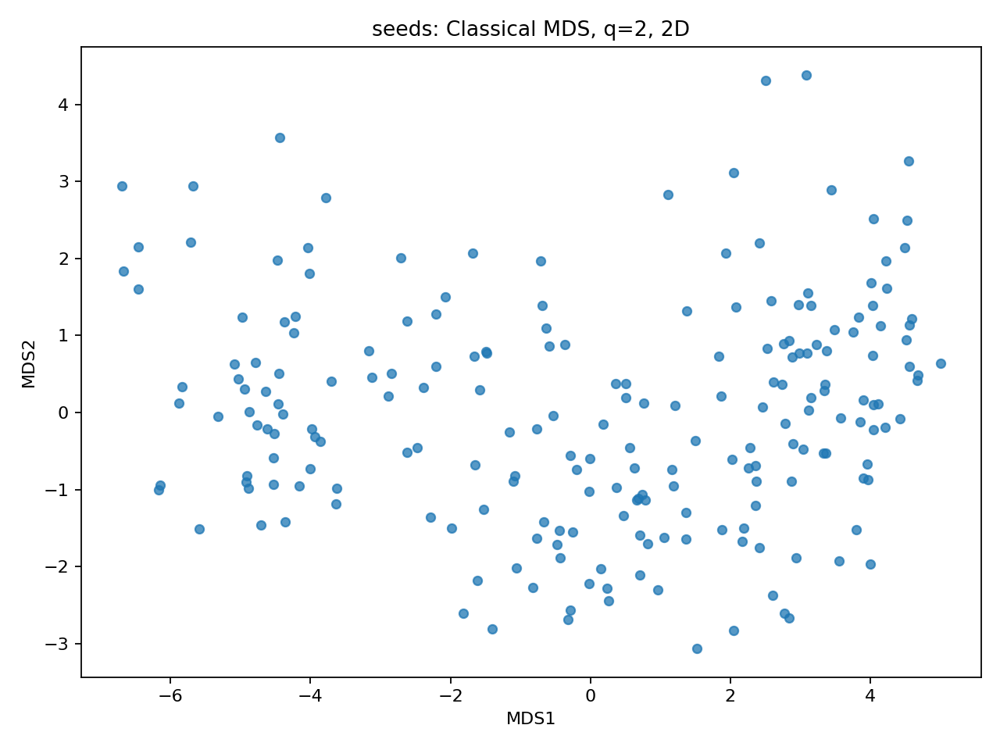
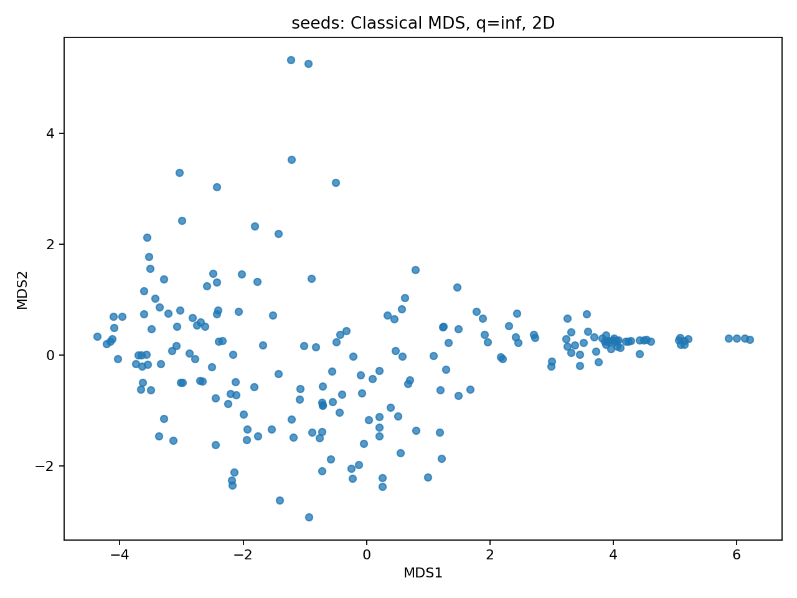
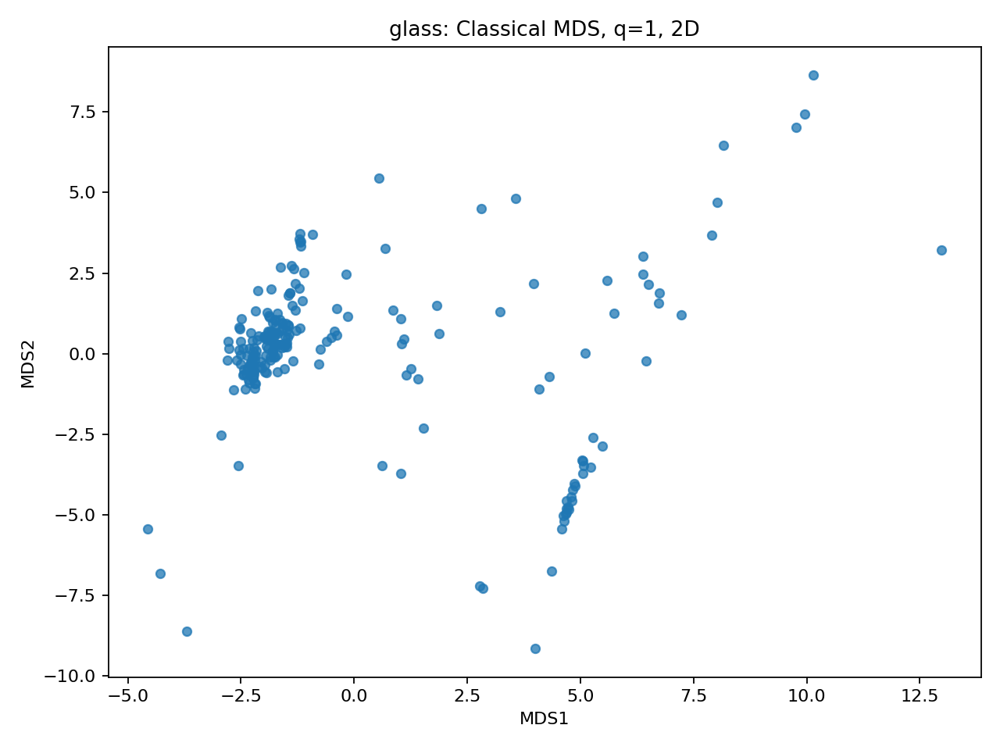
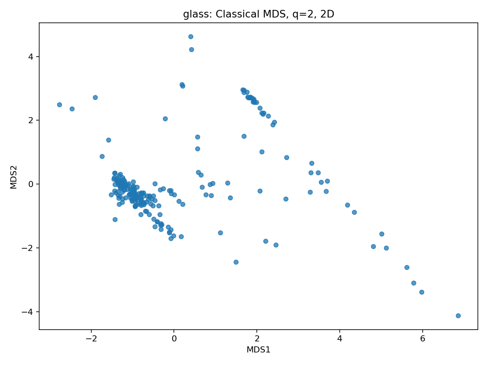
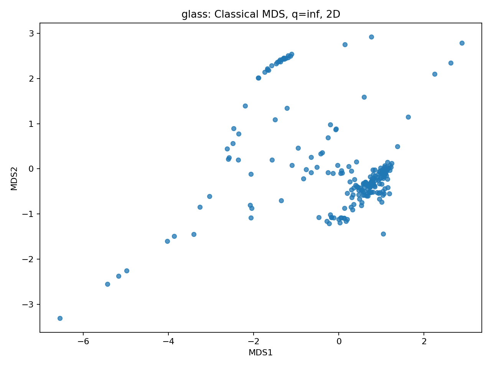

# Investigation of Minkowski distances using classical MDS

## 1. Introduction and research questions

How does q change distance ordering, local neighborhoods, Euclidean representability, and low-dimensional reconstruction? We compare exactly three feature-only UCI datasets without scaling. Selection used documented properties and feasibility, not q-dependent outcomes. Targets are excluded throughout.

## 2. Dataset selection record

Final selection was recorded at 2026-11-01T17:54:57.178621+00:00 before the runner launched any q experiment; the runner preserved a copy as [selection_used.json](stage4/results/selection_used.json). The same SHA-256-pinned matrix and original row/feature ordering were used for every q and dimension. No replacements occurred.

Chosen before experiments for contrasts in chemical scale imbalance (Wine), correlated geometry (Seeds), and oxide composition plus refractive index (Glass). Exactly three; no replacements. All n<=214, feature counts>=7; dense O(n^2) storage and O(n^3) EVD feasible with one BLAS thread.

### Wine — UCI 109

Official URL: https://archive.ics.uci.edu/dataset/109/wine. Source: `data/stage4/sources/wine.zip` containing `wine.data`. Final slug: `wine`; dimensions **178 × 13**. [Final numeric matrix](data/stage4/wine.csv). Rows are individual wine samples, wheat kernels, or glass samples, respectively; source files have no header, so the first source row is preserved as an observation.

Features, in order: alcohol, malic_acid, ash, alcalinity_of_ash, magnesium, total_phenols, flavanoids, nonflavanoid_phenols, proanthocyanins, color_intensity, hue, od280_od315, proline. Excluded: column 1 cultivar class. Official documentation: no missing values; no missing marker specified. All rows parse as finite numbers. No imputation or row removal. Zeros retained.

### Seeds — UCI 236

Official URL: https://archive.ics.uci.edu/dataset/236/seeds. Source: `data/stage4/sources/seeds.zip` containing `seeds_dataset.txt`. Final slug: `seeds`; dimensions **210 × 7**. [Final numeric matrix](data/stage4/seeds.csv). Rows are individual wine samples, wheat kernels, or glass samples, respectively; source files have no header, so the first source row is preserved as an observation.

Features, in order: area, perimeter, compactness, kernel_length, kernel_width, asymmetry_coefficient, groove_length. Excluded: column 8 variety code; official prose lists exactly seven geometric features, despite incomplete API variable metadata. Official documentation: no missing values; no missing marker specified. All rows parse as finite numbers. No imputation or row removal. Zeros retained.

### Glass Identification — UCI 42

Official URL: https://archive.ics.uci.edu/dataset/42/glass+identification. Source: `data/stage4/sources/glass.zip` containing `glass.data`. Final slug: `glass`; dimensions **214 × 9**. [Final numeric matrix](data/stage4/glass.csv). Rows are individual wine samples, wheat kernels, or glass samples, respectively; source files have no header, so the first source row is preserved as an observation.

Features, in order: refractive_index, sodium, magnesium, aluminum, silicon, potassium, calcium, barium, iron. Excluded: column 1 ID and column 11 glass class. Official documentation: no missing values; no missing marker specified. All rows parse as finite numbers. No imputation or row removal. Zeros retained.

Wine and Glass feature roles and missingness were read from the archive .names files. Seeds was checked against its preserved official page and API additional_info.variable_info: seven geometric features, no missingness. The API num_features=0 and empty variable-role entries are incomplete metadata; they were not interpreted as absence of features. The eighth raw column is an excluded variety code, not an eighth measurement. No class information was used in experiments.

## 3. Methodology

Distances are D_ij=(sum_r |x_ir-x_jr|^q)^(1/q), or max_r |x_ir-x_jr| for q=inf. All six q values (1, 1.5, 2, 3, 4, inf) use the existing mds.py CLI, separately in dimensions 2 and 3: 36 subprocess executions. No high-level MDS routine is used.

Classical STRAIN constructs G=-0.5 H(D∘D)H, H=I-11ᵀ/n, implemented by equivalent row/column means. numpy.linalg.eigh supplies symmetric eigenpairs; sorted eigenvalues are clipped below zero for Y=V_k sqrt(max(lambda_k,0)). mds.py was not modified. The negative tolerance is tau=100*eps*n*max(1,max_i|lambda_i|), with float64 eps. Meaningful negatives satisfy lambda<-tau; tiny negative values are rounding noise, but every negative value is clipped in construction.

Metrics: N−=count(lambda<-tau); M−=sum_{lambda<-tau}|lambda|. Positive mass capture P_k=sum_{i<=k}max(lambda_i,0)/sum_i max(lambda_i,0). Normalized distance error E_k=sqrt(sum_{i<j}(||y_i-y_j||₂-D_ij)²/sum_{i<j}D_ij²). The same formula normalizes by original distance energy for each q, enabling comparison despite overall distance magnitude changes; it does not remove feature-unit effects. Positive mass includes tiny positive eigenvalues consistently.

Neighborhood agreement is |N_q(i)∩N_2(i)|/10 for 10 nearest neighbors, self excluded. Exact ties are resolved by original row order using stable sorting. Most/least stable rows maximize/minimize mean overlap across the five nonbaseline q values. All row references below are one-based final-matrix observation rows, excluding the CSV header. Baseline overlap is identically 1.

No standardization, normalization, or rescaling of feature values is performed. Temporary per-pair norm evaluation in mds.py only stabilizes the exact Minkowski formula numerically.

## 4. Numerical results

| Dataset | q | N− | M− | P₂ | P₃ | E₂ | E₃ | Mean 10-NN overlap |
|---|---|---:|---:|---:|---:|---:|---:|---:|
| wine | 1 | 111 | 947655.26 | 0.94329423 | 0.95596056 | 0.029561819 | 0.029813188 | 0.9247191 |
| wine | 1.5 | 114 | 98506.103 | 0.99328836 | 0.99498159 | 0.0063533486 | 0.0071578709 | 0.97921348 |
| wine | 2 | 0 | -0 | 0.99982715 | 0.99992211 | 0.00095511859 | 0.00045559504 | 1 |
| wine | 3 | 68 | 25584.95 | 0.99865914 | 0.99888629 | 0.0036523478 | 0.00337297 | 0.98033708 |
| wine | 4 | 72 | 27672.289 | 0.99860148 | 0.99880737 | 0.004634037 | 0.0041443037 | 0.97134831 |
| wine | inf | 72 | 28227.916 | 0.99858232 | 0.99880662 | 0.0055587419 | 0.0049846024 | 0.94101124 |
| seeds | 1 | 131 | 1863.4897 | 0.85030287 | 0.88840612 | 0.084199288 | 0.081558817 | 0.84619048 |
| seeds | 1.5 | 138 | 284.06794 | 0.93148566 | 0.95172633 | 0.03847706 | 0.032417581 | 0.94333333 |
| seeds | 2 | 0 | -0 | 0.99301765 | 0.99867556 | 0.011010763 | 0.0022248228 | 1 |
| seeds | 3 | 84 | 146.80877 | 0.93132963 | 0.95949177 | 0.044079247 | 0.031743132 | 0.93761905 |
| seeds | 4 | 100 | 208.98519 | 0.90628591 | 0.94348593 | 0.065116787 | 0.048239615 | 0.90761905 |
| seeds | inf | 122 | 376.39842 | 0.84836105 | 0.89044094 | 0.098040912 | 0.079474564 | 0.85857143 |
| glass | 1 | 139 | 1481.7058 | 0.54916532 | 0.66451456 | 0.27420287 | 0.17055763 | 0.8588785 |
| glass | 1.5 | 145 | 175.28324 | 0.65945158 | 0.77412111 | 0.26069615 | 0.16467379 | 0.93971963 |
| glass | 2 | 0 | -0 | 0.73939801 | 0.84719844 | 0.25241863 | 0.1739072 | 1 |
| glass | 3 | 73 | 78.513035 | 0.71890317 | 0.80896936 | 0.24623578 | 0.12450941 | 0.92757009 |
| glass | 4 | 88 | 114.33655 | 0.70871249 | 0.79428833 | 0.24663037 | 0.12489038 | 0.89392523 |
| glass | inf | 103 | 235.20512 | 0.65535414 | 0.73508048 | 0.25463545 | 0.12963513 | 0.79719626 |

Full-precision values and per-run tolerance are in [metrics.csv](stage4/results/metrics.csv). Every CLI run passed distance symmetry/nonnegativity/finiteness/zero diagonal, Gram symmetry and explicit double-centering equivalence, shape, centering, finite coordinates, eigenvalue ordering/clipping, eigenpair residual, orthonormality, CSV round trip, and PNG decoding checks. All 36 diagnostic JSONs are preserved.

## 5. Neighborhood stability and distance-order changes

**Wine:** across nonbaseline q, per-row mean overlap ranges from 0.800000 to 1.000000. Most stable rows: [1, 7, 13, 14, 17, 22, 26, 30, 31, 33, 35, 37, 39, 42, 45, 48, 49, 50, 51, 53, 57, 59, 64, 66, 85, 95, 102, 106, 109, 110, 120, 123, 145, 161, 166, 167]; least stable rows: [70]. Lowest dataset mean agreement occurs at q=1 (0.924719). These row lists include all exact ties, without target-based selection.

**Seeds:** across nonbaseline q, per-row mean overlap ranges from 0.780000 to 1.000000. Most stable rows: [57]; least stable rows: [117]. Lowest dataset mean agreement occurs at q=1 (0.846190). These row lists include all exact ties, without target-based selection.

**Glass Identification:** across nonbaseline q, per-row mean overlap ranges from 0.620000 to 1.000000. Most stable rows: [193, 199, 200]; least stable rows: [190]. Lowest dataset mean agreement occurs at q=inf (0.797196). These row lists include all exact ties, without target-based selection.

Per-observation overlaps at every q are preserved in [neighborhoods.json](stage4/results/neighborhoods.json). Subunit agreement establishes changes in nearest-neighbor membership under the specified tie rule; it is not explained by multiplying all distances by a common constant. Exact and near ties can influence membership, so this statistic does not establish a complete ordering of all pairs.

## 6. Dataset-specific findings

### Wine

Largest absolute negative mass occurs at q=1 (M−=947655.26); this comparison is within this dataset's native units. Lowest E₂ is at q=2 (0.000955119), lowest E₃ at q=2 (0.000455595). Across q, P₂ ranges 0.943294–0.999827; P₃ ranges 0.955961–0.999922.

Measured native-unit squared-distance contributions (mean pairwise feature squared difference divided by their sum) are proline 99.77%, magnesium 0.21%, alcalinity_of_ash 0.01%. These quantify dominance at q=2; they do not prove identical dominance for all q.





These native 2D views support inspection of concentration and spread. Point style/order and panel size are fixed. Each panel has independently determined axes and automatic axis limits; orientation, handedness, and plotted span are not shared. Apparent rotations/reflections are not evidence of neighborhood changes; geometric conclusions above use invariant numerical measures.

### Seeds

Largest absolute negative mass occurs at q=1 (M−=1863.4897); this comparison is within this dataset's native units. Lowest E₂ is at q=2 (0.0110108), lowest E₃ at q=2 (0.00222482). Across q, P₂ ranges 0.848361–0.993018; P₃ ranges 0.888406–0.998676.

Measured native-unit squared-distance contributions (mean pairwise feature squared difference divided by their sum) are area 65.06%, asymmetry_coefficient 17.37%, perimeter 13.11%. These quantify dominance at q=2; they do not prove identical dominance for all q.





These native 2D views support inspection of concentration and spread. Point style/order and panel size are fixed. Each panel has independently determined axes and automatic axis limits; orientation, handedness, and plotted span are not shared. Apparent rotations/reflections are not evidence of neighborhood changes; geometric conclusions above use invariant numerical measures.

### Glass Identification

Largest absolute negative mass occurs at q=1 (M−=1481.7058); this comparison is within this dataset's native units. Lowest E₂ is at q=3 (0.246236), lowest E₃ at q=3 (0.124509). Across q, P₂ ranges 0.549165–0.739398; P₃ ranges 0.664515–0.847198.

Measured native-unit squared-distance contributions (mean pairwise feature squared difference divided by their sum) are magnesium 33.00%, calcium 32.13%, sodium 10.58%. These quantify dominance at q=2; they do not prove identical dominance for all q.





These native 2D views support inspection of concentration and spread. Point style/order and panel size are fixed. Each panel has independently determined axes and automatic axis limits; orientation, handedness, and plotted span are not shared. Apparent rotations/reflections are not evidence of neighborhood changes; geometric conclusions above use invariant numerical measures.

## 7. Cross-dataset comparison

Mathematically, increasing q makes the largest coordinate differences relatively more important, and each fixed pair distance is nonincreasing with q. Neither fact implies preserved relative distance ordering. The q=2 Gram matrix is positive semidefinite in exact arithmetic; non-Euclidean Minkowski distances need not admit an exact Euclidean embedding. Meaningful negative mass measures the spectral part discarded by the PSD approximation, not distance RMSE itself.

Empirically, the table allows q effects to be separated from overall units through normalized error and overlap. Absolute negative masses should not be ranked across datasets as a scale-free measure. The best normalized distance q need not be 2, and more dimensions need not monotonically improve distance error for non-Euclidean inputs: STRAIN optimizes Gram approximation, not distance stress. Claims of feature dominance are supported by measured contributions above, rather than labels or visual clusters.

Across all three datasets, q=1 has the largest absolute negative mass, q=2 has zero meaningful negative eigenvalues, and every nonbaseline q changes some 10-NN neighborhoods. Wine is most stable in aggregate (nonbaseline mean agreements 0.9247–0.9803), Seeds intermediate (0.8462–0.9433), and Glass reaches the lowest agreement at infinity (0.7972). These are empirical outcomes, not general norm theorems.

Wine and Seeds both minimize normalized 2D and 3D distance error at q=2. Glass instead minimizes both at q=3 (E₂=0.246236, E₃=0.124509), despite its genuine negative spectrum. Thus positive semidefiniteness does not guarantee the best low-dimensional relative distance error across different distance definitions. Wine captures over 94% positive mass in 2D for every q; Glass captures only about 55–74%. Proline accounts for 99.77% of Wine squared-distance energy, while the leading Glass features magnesium and calcium contribute 33.00% and 32.13%. This supports the tentative explanation that Wine geometry is dominated by one native-unit measurement, whereas Glass has more competing geometric directions. Seeds is also scale-imbalanced (area 65.06%) but its asymmetry coefficient contributes 17.37%, more than perimeter (13.11%); a purely size-only explanation would miss that evidence.

The nine figures show raw independently oriented configurations, so only numerical comparisons establish changes in local membership. No visual claim of class structure is made. In particular, orientation differences and changes in axis scale should not be interpreted as distance-order reversals.

## 8. q = 2 centered PCA validation

Independent NumPy SVD of X-column_means(X), with no scaling, supplies PCA coordinates. Compare Euclidean distances from the saved MDS embeddings to those PCA configurations.

| Dataset | Dimensions | Maximum absolute pairwise-distance discrepancy | Tolerance | Passed |
|---|---:|---:|---:|---|
| wine | 2 | 2.30926389e-12 | 5.54201467e-09 | True |
| wine | 3 | 1.09423581e-11 | 5.54201467e-09 | True |
| seeds | 2 | 1.59872116e-14 | 5.56155732e-11 | True |
| seeds | 3 | 1.74305015e-14 | 5.56155732e-11 | True |
| glass | 2 | 1.44103479e-14 | 5.71967214e-11 | True |
| glass | 3 | 5.48450174e-14 | 5.71967214e-11 | True |

All six comparisons confirm the expected equivalence within scale-aware float64 tolerance. Coordinates are not required to agree elementwise. PCA coordinates were never inputs to MDS. [Full validation](stage4/results/pca_validation.json).

## 9. Feature-unit sensitivity and limitations

Wine mixes chemical assays with markedly different numerical ranges. Proline and magnesium can dominate native-unit distances; the measured shares above test this claim. The preserved UCI names do not specify physical units for every assay, so no unsupported unit conversion is inferred. Comparing q here is meaningful for this exact recorded representation, not as a unit-invariant chemical geometry.

Seeds mixes area, perimeter, lengths, compactness=4*pi*A/P², and an asymmetry coefficient. Length/area and dimensionless shape quantities cannot be physically added without a unit convention. The official metadata does not specify all absolute physical units. Correlated size features can repeatedly count size; native-unit area and shape contributions above indicate the degree, without proving causal explanations.

Glass combines dimensionless refractive index with oxide weight percentages. RI has very small variation, while oxide composition varies by percentage points and includes genuine zeros. A percentage sum constraint also induces dependence. Its largely common oxide units make q contrasts interpretable within composition, but inclusion of RI and the choice of percentage units still prevent unit-invariant conclusions.

None of the three was rescaled as required. Changing measurement units could change all findings, including neighborhood identities. Observational association is not causation. No labels were used; no claim about supervised class separation is made. The neighborhood result is conditional on k=10 and deterministic tie handling; there was no sensitivity sweep over k. Dense storage is quadratic and EVD cubic, restricting scalability.

## 10. Conclusions

Changing q changes the balance of coordinate contributions and can change neighborhoods. The measured negative masses, positive spectral capture, and normalized errors distinguish representation loss from roundoff. Euclidean q=2 uniquely supplies the general centered-PCA equivalence; the six numerical tests confirm it here. Dataset-specific numerical results should be interpreted in native units rather than used to recommend a universally optimal q.

## 11. Reproducibility instructions

Versions: Python 3.12.14, NumPy 2.3.5, Matplotlib 3.10.8, Pillow 12.3.0. No random procedures are used. New AI-written preparation, experiment, and report scripts are preserved; existing mds.py and earlier tracked files were not modified.

From the repository root, with these package versions installed:

```sh
python3 stage4/prepare_data.py
OPENBLAS_NUM_THREADS=1 OMP_NUM_THREADS=1 python3 stage4/run_experiments.py
python3 stage4/build_report.py
```

The preserved official ZIPs allow offline preparation. prepare_data.py reconstructs headers, excludes metadata, validates finite matrices, and records selection before any experiments. The runner validates matrix hashes before computing distances. To repeat a single CLI run:

```sh
python3 mds.py --input data/stage4/wine.csv --q 1.5 --dimensions 3 --output-dir stage4/results
```

Sources: official UCI Wine ZIP https://archive.ics.uci.edu/static/public/109/wine.zip ; Seeds ZIP https://archive.ics.uci.edu/static/public/236/seeds.zip ; Glass ZIP https://archive.ics.uci.edu/static/public/42/glass+identification.zip . Documentation is preserved under data/stage4/sources; source and matrix hashes are in stage4/selection.json. Preserve existing selection records before intentionally regenerating them for a new run.

Outputs: three numeric matrices; 36 PNGs, 36 embedding CSVs, 36 diagnostic JSONs, 36 CLI logs under stage4/results; metrics.csv, neighborhoods.json, pca_validation.json, selection_used.json; selection.json, preparation/experiment/report scripts, protected_hashes.json and this report. The nine figures above are supporting evidence; all 36 plots remain available. Nothing is committed or pushed by these scripts.
